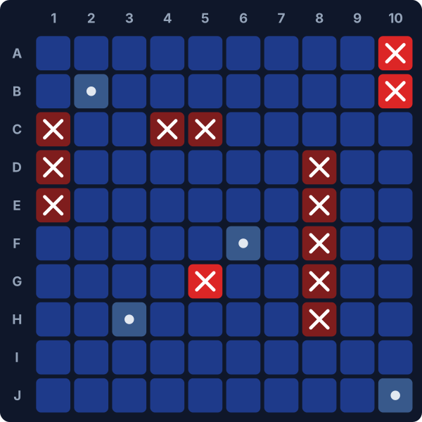

# Battleship in Power BI (100% DAX + SVG)

A playable **Battleship** game built inside a standard Power BI report, with **no custom visual and no line of JavaScript**. The board, the hits and the fleet status are SVG images generated on the fly by DAX measures. The game state lives in a slicer.

<p align="center">
  
</p>

> **Level 1 of 3** of a learning series on interactive experiences in Power BI:
> 1. **Battleship, DAX + SVG** (this repo)
> 2. Data Shooter: a 2D custom visual in TypeScript + Canvas *(coming soon)*
> 3. A 3D custom visual with three.js *(coming soon)*

## Features

- 10 x 10 board drawn by a single DAX measure (`Board SVG`).
- 3 hidden fleets to choose from (Carrier 5, Battleship 4, Cruiser 3, Submarine 3, Destroyer 2), ships never touch.
- Hits, misses, sunk ships and accuracy computed live.
- Score with a victory bonus that rewards finishing in few shots.
- Fleet panel (`Fleet SVG`) that crosses out sunk ships.
- Enemy fleet revealed when the game is won.

## How it works

| Concept | Implementation |
| --- | --- |
| Game state | A multi-select slicer on the disconnected table `Shots`: every selected cell is a shot. Clearing the slicer starts a new game. |
| Hidden fleet | Table `Ships`, filtered by a single-select `Game` slicer. |
| Hit detection | Set operations: `INTERSECT ( shots, shipCells )`. |
| Sunk ship | A ship is sunk when `EXCEPT ( shipCells, shots )` is empty, evaluated per ship with a context transition. |
| Empty slicer = 0 shots | `FILTER ( VALUES ( Shots[Cell] ), ISFILTERED ( Shots[Cell] ) )` returns an empty table when nothing is selected, instead of all 100 cells. |
| Rendering | `CONCATENATEX` over the `Grid` table builds one `<rect>` per cell into an SVG string, returned as a `data:image/svg+xml` URI. With its Data category set to *Image URL*, Power BI displays the measure as an image. |

DAX techniques showcased: calculated tables (`DATATABLE`, `GENERATESERIES`, `CROSSJOIN`), disconnected tables, `ISFILTERED`, `INTERSECT` / `EXCEPT` / `TREATAS`, context transition, `CONCATENATEX` string building, SVG in measures.

## Repository structure

```
dax/
  tables.dax       Grid, Shots and Ships calculated tables
  measures.dax     Game measures and the two SVG measures
docs/
  BUILD.md         Step-by-step guide to build the report
assets/            Images for this README
pbi-battleship-dax.pbip              Power BI project (after you save it)
pbi-battleship-dax.Report/
pbi-battleship-dax.SemanticModel/
```

## Getting started

- **Play**: open `pbi-battleship-dax.pbip` in Power BI Desktop, pick a game, click cells.
- **Build it yourself**: follow [docs/BUILD.md](docs/BUILD.md) (about 20 minutes).

## Limitations

- The slicer cannot remember the order of the shots, so there is no "last shot" highlight and no turn-based enemy.
- Static layouts: DAX has no persistent random state, so fleets are predefined (3 games).
- Tested design target: Power BI Desktop. SVG rendering in the Power BI mobile app may differ.

These limits are exactly what Level 2 (a custom visual with its own state and game loop) will remove.

## Credits and license

Inspired by the Power BI community's DAX games, notably Phil Seamark's DAX maze, and by *Call of Power BI: Data Ops*.

MIT License, see [LICENSE](LICENSE).
