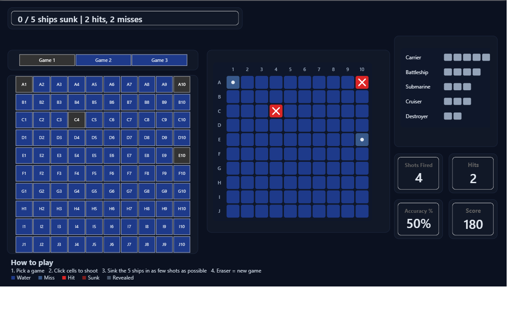

# Battleship in Power BI (100% DAX + SVG)

A playable **Battleship** game built inside a standard Power BI report, with **no custom visual and no JavaScript**. The board, the shots and the fleet status are SVG images generated on the fly by DAX measures, and the game state lives in a slicer.

The project is stored as a **Power BI Project (PBIP)**: the semantic model is versioned as TMDL and the report as PBIR, so every change is a readable Git diff.

<p align="center">
  
</p>

## How to play

1. Pick a game (Game 1, 2 or 3): each one hides a different fleet.
2. Click cells in the fire control grid: every selected cell is a shot.
3. Sink the 5 ships (Carrier 5, Battleship 4, Cruiser 3, Submarine 3, Destroyer 2) in as few shots as possible.
4. Clear the grid with the eraser to start a new game.

| Board color | Meaning |
| --- | --- |
| Deep blue | Water, not shot yet |
| Light blue with a dot | Miss |
| Red with a cross | Hit |
| Dark red | Ship sunk |

Score: +100 per hit, +250 per ship sunk, -10 per miss, plus a victory bonus that rewards finishing in few shots.

## How it works

| Concept | Implementation |
| --- | --- |
| Game state | A multi-select slicer on the disconnected table `Shots`: every selected cell is a shot. |
| Hidden fleets | Table `Ships` (3 fleets, 17 cells each, ships never touch), filtered by a single-select `Game` slicer. |
| Hit detection | Set operations: `INTERSECT ( shots, shipCells )`. |
| Sunk ship | `EXCEPT ( shipCells, shots )` is empty, evaluated per ship with a context transition. |
| Empty slicer = 0 shots | `FILTER ( VALUES ( Shots[Cell] ), ISFILTERED ( Shots[Cell] ) )` returns nothing when no cell is selected. |
| Rendering | `CONCATENATEX` builds one SVG `<rect>` per cell, returned as a `data:image/svg+xml` URI; the measure's data category is *Image URL*. |
| Grid layout | `Shots[Cell]` is sorted by `Col * 100 + RowIdx` so the column-filled tile slicer mirrors the board. |

DAX techniques: calculated tables (`DATATABLE`, `GENERATESERIES`, `CROSSJOIN`), disconnected tables, `ISFILTERED`, `INTERSECT` / `EXCEPT` / `TREATAS`, context transition, string building with `CONCATENATEX`, SVG in measures.

## Repository structure

```
pbi-battleship-dax.pbip                  Open this file in Power BI Desktop
pbi-battleship-dax.SemanticModel/
  definition/tables/Grid.tmdl            10 x 10 board
  definition/tables/Shots.tmdl           Fire control (slicer source)
  definition/tables/Ships.tmdl           The 3 hidden fleets
  definition/tables/_Measures.tmdl       Game measures and the two SVG measures
pbi-battleship-dax.Report/
  definition/pages/.../visuals/          One folder per visual (PBIR)
  StaticResources/RegisteredResources/   Battleship Dark theme
assets/report.png                        Screenshot
```

## Getting started

1. Clone the repository:
   ```
   git clone https://github.com/skandarany/pbi-battleship-dax.git
   ```
2. Open `pbi-battleship-dax.pbip` in Power BI Desktop (Windows).
3. Click **Refresh** once: the data cache is not stored in Git.
4. Pick a game and start shooting.

## Development workflow

Built step by step with Git, one commit per logical step:

- `.gitignore` excludes local files (`.pbi/cache.abf`, `.pbi/localSettings.json`) and any `.pbix`.
- Model changes (tables, measures) were committed on `main`; the measures were created in one go with a script in Power BI's TMDL view.
- The report design was built on a `feature/design` branch and merged through a pull request.

## Limitations

- A slicer has no memory of the order of the shots: there is no turn-based enemy and no "last shot" highlight.
- DAX has no persistent random state, so the three fleets are predefined.
- Designed for Power BI Desktop; SVG rendering may differ on the Power BI mobile app.

## Roadmap

This is **level 1 of 3** of a learning series on interactive experiences in Power BI:

1. **Battleship, DAX + SVG** (this repository)
2. Data Shooter: a 2D custom visual in TypeScript + Canvas
3. A 3D custom visual with three.js

## Credits and license

Inspired by the Power BI community's DAX games, notably Phil Seamark's DAX maze, and by *Call of Power BI: Data Ops*.

MIT License, see [LICENSE](LICENSE).
